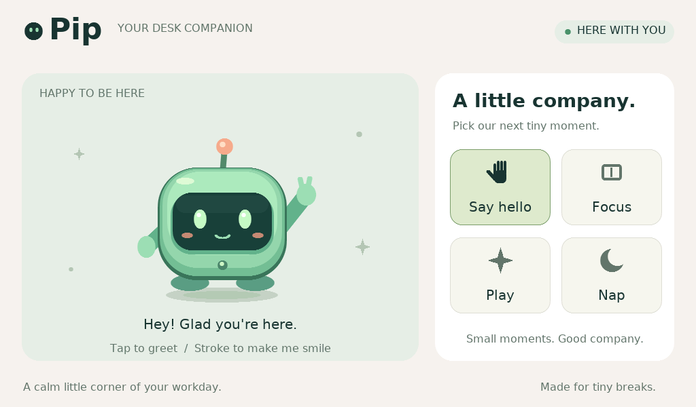

# desk-buddy

A standalone touchscreen desk companion named **Pip**, built for the
**Waveshare ESP32-S3-Touch-LCD-7B (1024 × 600)** using Arduino C++.
Tap Pip to wave, stroke it for hearts, or choose Hello, Focus, Play, or Nap.
It runs locally on the board and needs only power after upload. Computer
integration is not implemented.



## Start here

1. Read this project map to find the code you want to change.
2. Follow [setup and upload](docs/setup.md) to run it on your board.
3. Read [architecture](docs/architecture.md) for the runtime flow and boundaries.
4. Follow [validation](tests/README.md) when changing behavior or drawing.

## Project map

```text
desk-buddy/                         Git repository root
├── README.md                       Quick orientation
├── AGENTS.md                       Guidance for coding agents
├── docs/
│   ├── setup.md                    Board settings, upload, troubleshooting
│   ├── architecture.md             Runtime flow and module boundaries
│   └── assets/Preview.png          Preview from the original renderer
├── licenses/                       App, hardware driver, and font licenses
├── firmware/desk-buddy/
│   ├── desk-buddy.ino              Arduino setup()/loop() entry point
│   └── src/
│       ├── app/                    Hardware startup, scheduling, redraws, logs
│       ├── companion/              Character state and gesture interpretation
│       ├── graphics/               Canvas, colors, layout, scene, mascot
│       ├── assets/                 Embedded font data
│       └── hardware/               Included Waveshare display/touch drivers
└── tests/                          Host C++ behavior and rendering checks
```

The firmware remains an Arduino sketch: open
`firmware/desk-buddy/desk-buddy.ino` in Arduino IDE. Keep the complete `src/`
tree with it; Arduino compiles this directory recursively. Git remains rooted
in the outer `desk-buddy` directory.

## Where to make changes

| Change | Start with |
| --- | --- |
| Tap, petting, wake-up behavior, phrases | `src/companion/Interaction.h` |
| Moods and character state | `src/companion/State.h` |
| Character appearance and motion | `src/graphics/Mascot.h` |
| Background, buttons, labels | `src/graphics/Scene.h` and `Layout.h` |
| Palette or drawing primitives | `src/graphics/Color.h` and `Canvas.h` |
| Touch polling, animation rate, redraws, logging | `src/app/Runtime.cpp` |
| Board pins, display timing, touch controller | `src/hardware/` |

Paths above are relative to `firmware/desk-buddy/`.

## Performance and validation

Normal animation redraws a 320 × 302 region, targeting 25 application updates
per second. Controls redraw when their state changes. The framebuffer is not
synchronized to vertical blank, so tearing is possible.

Host tests exercise gestures and full/partial rendering. They do not validate
ESP32 hardware. The full firmware build and physical display/touch behavior
remain unverified in this environment; validate with your Arduino board setup.

## Licenses and provenance

Original companion code: [MIT](licenses/LICENSE-Pip.txt).
Included Waveshare drivers: [Apache-2.0](licenses/LICENSE-Waveshare.txt).
Embedded fonts: [DejaVu/Bitstream](licenses/LICENSE-Font.txt).
Driver origins and modifications are documented in [setup](docs/setup.md).
